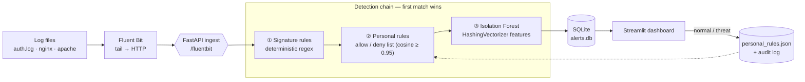

<div align="center">

#  LogRecon

**Lightweight log anomaly detection for people who actually have to read the logs.**

Signature rules + an Isolation Forest + a feedback loop you control —
in a single `./install.sh`.

[](LICENSE)
[](https://www.python.org/)
[](https://docs.docker.com/compose/)
[](https://fluentbit.io/)
[](https://streamlit.io/)

[Quick start](#-quick-start) ·
[How it works](#-how-it-works) ·
[Dashboard](#-the-dashboard) ·
[Security](#-security-model) ·
[Limitations](#-known-limitations)

</div>

---

## Why LogRecon?

A busy server produces thousands of log lines an hour. Almost all of them are
noise; a handful matter. SOC analysts, DevOps and Blue Team engineers don't need
another SIEM to deploy — they need something that **surfaces the few lines worth
a human's attention** and **learns from the analyst's decisions**.

LogRecon is built around that idea:

- **Obvious attacks never reach the queue.** A deterministic signature layer
  flags path traversal, SQLi, XSS, Log4Shell, webshells and scanners instantly —
  no model, no classification step.
- **Everything unusual is ranked, not dumped.** An Isolation Forest learns what
  *normal* looks like for your server and escalates only what deviates.
- **Your verdicts become rules.** One click — *"This is normal"* or *"Real
  threat"* — and the system adapts. Similar lines stop bothering you (or get
  escalated automatically).
- **It's small.** No GPU, no PyTorch, no cluster. Three containers with a combined
  memory cap of about 1.1 GB, and it keeps working when parts of it are missing.

##  Features

| | |
|---|---|
|  **Signature layer** | 8 attack categories, with URL-decoding (up to 3 rounds) and SQL-comment normalisation to defeat the common evasions (`%2e%2e%2f`, `%252e…`, `UNI/**/ON`). |
|  **Isolation Forest** | `HashingVectorizer` (4096 dims, fixed memory, no vocabulary to fit) + `IsolationForest` (200 trees). Trains in seconds. |
|  **Personal rules** | Allow/deny list built from analyst decisions via cosine similarity (threshold 0.95). Works instantly, no retraining. |
|  **Anti-poisoning guardrails** | Rate limits, minimum specificity, conflict detection and an append-only audit log with reviewer attribution. |
|  **Fluent Bit ingest** | Tail any log file → HTTP → FastAPI. Offsets survive restarts. |
|  **Streamlit dashboard** | Prioritised alert queue, one-click classification, and a manual "classify any line" panel. |
|  **Locked-down by default** | Ingest service has no published port and no internet access; dashboard bound to `127.0.0.1`. |
|  **Graceful degradation** | No trained model? Signatures still work. The service doesn't crash because a layer is missing. |

### Supported log formats

nginx / Apache combined access logs · Apache error logs · syslog (classic
`Sep 27 05:52:41` **and** ISO 8601 timestamps, including hyphenated services like
`sshd-session`) · OpenStack structured service logs.

Parser coverage on the public [LogHub](https://github.com/logpai/loghub) 2k
samples: **Linux ≈ 99.6 %**, **OpenStack ≈ 100 %**, **Apache ≈ 92 %** (the
remainder are truncated artefacts in the dataset). Unparsed lines are not
dropped — they fall through to a generic record and are still scored.

---

## 🧭 How it works



Every line goes through the layers **in priority order, and the first match stops
the chain**:

| # | Layer | What it does | Result |
|---|-------|--------------|--------|
| 1 | **Signature rules** | Regex match on the raw line plus URL-decoded and comment-stripped variants. Needs no trained model. | `signature_match` — shown immediately, never sent to classification |
| 2 | **Personal rules** | Compares the line's vector with analyst-confirmed threats and false positives. | `known_threat` (escalated) or silently suppressed |
| 3 | **Isolation Forest** | Scores how unlike "normal" the line is. | `model_anomaly` — queued for classification |

### Signature categories

`path_traversal` · `sql_injection` · `xss` · `command_injection` · `log4shell` ·
`webshell` · `scanner_tool` · `sensitive_path`

Add your own by appending a tuple to `SIGNATURES` in `signature_rules.py`, then
`docker compose restart ingest`:

```python
('custom', re.compile(r'your_pattern', re.IGNORECASE), 'short description'),
```

---

##  Quick start

**Requirements:** Docker with the Compose plugin. That's it.

```bash
git clone https://github.com/memspy/logrecon.git
cd logrecon
./install.sh
```

`install.sh` builds the image, generates a synthetic baseline and trains the
initial model (so the dashboard works on first launch), and starts the services.

Open **http://localhost:8501**.

> [!NOTE]
> The first model is trained on *synthetic* data purely so you can see the
> pipeline working. Before relying on it, [train on your own logs](#-training-on-your-own-logs).

### Try it without any real logs

```bash
docker compose exec ingest python -c "
import json, urllib.request
lines = [
  {'log': '10.0.0.5 - - [26/Oct/2026:10:00:01 +0000] \"GET /../../../../etc/passwd HTTP/1.1\" 403 256'},
  {'log': '10.0.0.9 - - [26/Oct/2026:10:00:02 +0000] \"GET /index.php?id=1 UNION SELECT user,pass FROM users HTTP/1.1\" 200 512'},
]
req = urllib.request.Request('http://localhost:8080/fluentbit',
                             data=json.dumps(lines).encode(),
                             headers={'Content-Type': 'application/json'})
print(urllib.request.urlopen(req).read().decode())
"
```

Both lines appear under **🚨 Known attack signatures** in the dashboard.

### Ingest real logs

1. Edit `fluent-bit.docker.conf` and set `Path` to the file you want to watch
   (inside the container it's mounted under `/hostlogs`, e.g. `/hostlogs/auth.log`).
   Update `Match` in `[OUTPUT]` if you change the `Tag`.
2. Edit `docker-compose.yml` so the `fluent-bit` volume points at the directory
   you want to expose — **read-only**, and only that directory, not the project root.
3. Start the collector:

   ```bash
   docker compose --profile fluentbit up -d fluent-bit
   ```

By default Fluent Bit starts from the **end** of the file (`Read_from_Head false`),
so it won't replay your entire log history on first start. Read offsets are kept
in `./fluent-bit-state/`, so restarts don't produce duplicate alerts. File changes
are picked up by polling (`Refresh_Interval 2`), which is more reliable than inotify
across bind-mounts.

<details>
<summary><b>Running without Docker (bare metal)</b></summary>

```bash
python3 -m venv .venv && source .venv/bin/activate
pip install -r requirements.txt

python generate_sample_logs.py baseline
python train_baseline.py logs/server.log

uvicorn ingest_service:app --host 127.0.0.1 --port 8080 &
streamlit run app.py --server.address 127.0.0.1 --server.port 8501
```

Use `fluent-bit.conf` (instead of `fluent-bit.docker.conf`) and set `Path` to an
absolute path on your host.

</details>

---

##  The dashboard

Alerts are grouped by priority, most urgent first:

| Section | Source | Meaning |
|---------|--------|---------|
|  **Known attack signatures** | Layer 1 | Matched a signature. No decision needed. |
|  **Confirmed threats** | Layer 2 | Looks like something you previously marked as a real threat. |
|  **To classify** | Layer 3 | Unusual for this server. Needs your verdict. |
|  **Manual classification** | — | Always available: paste any log line and label it yourself. |

For every item in the queue:

- ** This is normal** → added to the allow-list. Similar lines stop alerting.
- ** Real threat** → added to the deny-list. Similar lines are escalated on sight.

Set your name in the sidebar — every decision is recorded with the reviewer.

> The dashboard UI strings are currently in Russian; localisation is on the
> [roadmap](#-roadmap).

---

## 🎓 Training on your own logs

Isolation Forest only knows what you show it. Give it a window of **normal,
representative traffic**:

```bash
docker compose run --rm ingest python train_baseline.py logs/server.log
docker compose restart ingest
```

Recommendations:

- Use several days of ordinary traffic, covering weekday/weekend cycles.
- Don't train on a period with a known incident.
- **Retrain regularly.** Baselines drift as your traffic changes; a stale model
  produces noise.
- Sanity-check the sensitivity on synthetic data before going live:
  `docker compose run --rm ingest python evaluate.py`

Detection strictness is controlled by `contamination` (default `0.02`) in
`anomaly_detector.py`.

---

##  Security model

LogRecon processes untrusted data, so the deployment is defensive by default.

- **Network isolation.** `ingest` and `fluent-bit` live on an `internal: true`
  Docker network — no route to the internet. The ingest port (`8080`) is **never
  published** to the host.
- **Dashboard on localhost only.** Published as `127.0.0.1:8501`. It sits on its
  own `ingress` network because Docker Desktop/WSL2 refuses to publish ports from
  an `internal` network.
- **Read-only log access.** Fluent Bit mounts log directories `:ro`.
- **Resource limits.** `512 MB / 1 CPU` for ingest and dashboard, `128 MB / 0.5 CPU`
  for Fluent Bit.

###  The dashboard has no built-in authentication

Do **not** expose port 8501 to the internet. Reach it via an SSH tunnel:

```bash
ssh -L 8501:127.0.0.1:8501 user@your-server
```

or place it behind a reverse proxy that handles authentication (OIDC, basic auth + TLS, etc.).

### Protection against rule poisoning

Because analysts' clicks change detection behaviour, those clicks are guarded:

| Guard | Default | Purpose |
|-------|---------|---------|
| Minimum specificity | ≥ 3 tokens | Rejects "normal" labels on lines too generic to be meaningful. |
| Conflict detection | similarity > 0.90 | Refuses to whitelist something close to a confirmed threat (and vice versa). |
| Rate limit | 20 additions/hour per list | Stops a mis-click spree or a compromised session from mass-whitelisting. |
| Audit log | append-only `personal_rules_audit.jsonl` | Every accepted **and rejected** change, with reviewer name. |

Rejections are shown in the dashboard and recorded in the audit log.

---

##  Project structure

```
logrecon/
├── install.sh                 # one-shot installer
├── docker-compose.yml         # ingest · dashboard · fluent-bit (profile)
├── Dockerfile
├── requirements.txt
│
├── ingest_service.py          # FastAPI: POST /fluentbit, GET /health
├── app.py                     # Streamlit dashboard
├── log_parser.py              # raw line → normalised record
├── signature_rules.py         # layer 1: deterministic attack signatures
├── personal_rules.py          # layer 2: allow/deny list + anti-poisoning
├── anomaly_detector.py        # layer 3: HashingVectorizer + Isolation Forest
├── storage.py                 # SQLite alert store
│
├── train_baseline.py          # train the Isolation Forest
├── evaluate.py                # sanity-check on a labelled synthetic set
├── generate_sample_logs.py    # synthetic logs for demos/tests
│
├── fluent-bit.docker.conf     # collector config (Docker)
├── fluent-bit.conf            # collector config (bare metal)
└── testing-checklist.md       # manual test plan
```

**Generated at runtime** (git-ignored): `model.joblib`, `alerts.db`,
`personal_rules.json`, `personal_rules_audit.jsonl`, `fluent-bit-state/`, `logs/`.

### Health check

```bash
docker compose exec ingest python -c \
  "import urllib.request;print(urllib.request.urlopen('http://localhost:8080/health').read().decode())"
```

`baseline_model_loaded: false` means no `model.joblib` was found — signature and
personal-rule layers still run; train a baseline to enable layer 3.

---

##  Known limitations

Honest list — please read before deploying:

- **Signatures are regex.** Normalisation covers URL-encoding (up to 3 rounds) and
  SQL inline comments. Combined or novel evasions are untested and may slip past
  layer 1 (layer 3 will usually still flag them as unusual).
- **Regex can't tell an attack from an article about an attack.** A blog post
  titled *"union select tutorial"* will match. Whitelist it via the dashboard.
- **Isolation Forest is per-line.** It cannot see attacks that are only visible as a
  *sequence* of individually normal events.
- **Baseline drift.** The model needs periodic retraining on fresh normal traffic.
- **No authentication in the dashboard** (see [Security model](#-security-model)).
- **Linux production hosts are the target**, but the Docker isolation has so far been
  verified on Docker Desktop (Windows/WSL2). Validate it on your own server with the
  checklist before trusting it.
- `testing-checklist.md` is currently in Russian.

---

##  Testing

A detailed manual plan — true positives, false-positive traps, evasion cases,
poisoning scenarios, network isolation and restart recovery — lives in
[`testing-checklist.md`](testing-checklist.md).

Quick signature smoke test:

```bash
docker compose run --rm ingest python -c "
from signature_rules import match
print(match('GET /../../../../etc/passwd'))
print(match('GET /catalog?category=environment'))   # -> None
"
```

---

##  Roadmap

- [ ] English dashboard + i18n
- [ ] Built-in authentication for the dashboard
- [ ] Multi-event (sequence) detection research
- [ ] Feedback loop for more alert types
- [ ] More signature packs and parser formats (journald, JSON logs)
- [ ] Prebuilt image on a container registry

Ideas and PRs welcome.

---

##  Contributing

1. Fork the repo and create a feature branch.
2. Add or update tests/checklist entries for your change.
3. Run `python -m py_compile *.py` and the signature smoke test above.
4. Open a pull request describing the problem and the approach.

Security issues: please report privately (via a GitHub Security Advisory)
rather than a public issue.

##  License

Released under the [MIT License](LICENSE).

---

<div align="center">
<sub>Built for the people who read logs at 4 a.m.</sub>
</div>
