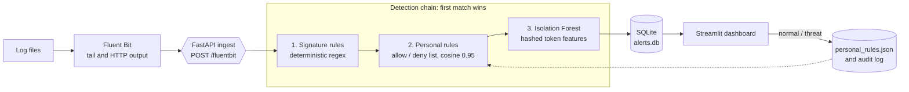

<div align="center">

# LogRecon

**Lightweight log anomaly detection for the people who have to read the logs.**

Signature rules, a learned baseline and a feedback loop you control, deployed with one script.

[](.github/workflows/ci.yml)
[](LICENSE)
[](https://www.python.org/)
[](https://docs.docker.com/compose/)
[](https://fluentbit.io/)

[Quick start](#quick-start) |
[How it works](#how-it-works) |
[Configuration](#configuration) |
[Dashboard](#the-dashboard) |
[Security](#security-model) |
[Limitations](#known-limitations)

</div>

---

## Overview

A busy server writes thousands of log lines an hour. Almost all of them are noise.
SOC analysts, DevOps and Blue Team engineers need something that surfaces the few
lines worth a human's attention and learns from the decisions they make, without
the weight of a full SIEM.

LogRecon does three things:

- **Flags known attacks immediately.** A deterministic signature layer catches path
  traversal, SQL injection, XSS, command injection, Log4Shell, webshells, scanners and
  probes for sensitive files. These never wait in a classification queue.
- **Learns what normal looks like.** An Isolation Forest trained on your own traffic
  queues unusual lines for review.
- **Turns analyst decisions into rules.** Mark a line as normal or as a real threat and
  similar lines are suppressed or escalated from then on, without retraining.

It is small: three containers with a combined memory cap of about 1.1 GB, no GPU and no
PyTorch. If a layer is unavailable (for example before a model has been trained), the
others keep working.

## Features

| | |
|---|---|
| Signature layer | Eight attack categories. Input is URL-decoded (up to three rounds) and stripped of SQL inline comments before matching, which defeats common evasions such as `%2e%2e%2f`, `%252e%252e%252f` and `UNI/**/ON`. |
| Isolation Forest | `HashingVectorizer` (4096 dimensions, fixed memory, no vocabulary to fit) and `IsolationForest` (200 trees). Trains in seconds. |
| Personal rules | Allow and deny lists built from analyst decisions using cosine similarity (threshold 0.95). Changes take effect in the running service without a restart. |
| Anti-poisoning guards | Rate limit, minimum specificity, conflict detection and an append-only audit log with reviewer attribution. |
| Fluent Bit ingest | Tail a log file, ship it over HTTP to a FastAPI service. Read offsets survive restarts. |
| Streamlit dashboard | Prioritised alert queue, one-click classification and a manual classification panel. |
| Locked-down deployment | The ingest service has no published port and no internet access. The dashboard is bound to `127.0.0.1`. |
| Graceful degradation | No trained model? Signatures still work. A missing layer never stops the service. |

### Supported log formats

nginx and Apache combined access logs, Apache error logs, syslog (classic
`Sep 27 05:52:41` and ISO 8601 timestamps, including hyphenated services such as
`sshd-session`), and OpenStack service logs.

Parser coverage on the public [LogHub](https://github.com/logpai/loghub) 2k samples is
about 99.6% for Linux, about 100% for OpenStack and about 92% for Apache (the remainder
are truncated lines in the dataset). Lines the parsers do not recognise are not dropped;
they are stored as generic records and still pass through every layer.

---

## How it works



Each line passes through the layers in priority order and the first match stops the chain.

| # | Layer | Behaviour | Alert type |
|---|-------|-----------|------------|
| 1 | Signature rules | Regex on the raw line plus its URL-decoded and comment-stripped variants. Needs no trained model. | `signature_match`, never sent to classification |
| 2 | Personal rules | Compares the line with analyst-confirmed threats and false positives. | `known_threat`, or silently suppressed |
| 3 | Isolation Forest | Scores how unlike the training baseline the line is. | `model_anomaly`, queued for classification |

### Signature categories

`path_traversal`, `sql_injection`, `xss`, `command_injection`, `log4shell`, `webshell`,
`scanner_tool`, `sensitive_path`.

To add your own, append a tuple to `SIGNATURES` in `signature_rules.py` and run
`docker compose restart ingest`:

```python
('custom', re.compile(r'your_pattern', re.IGNORECASE), 'short description'),
```

---

## Quick start

Requirements: Docker with the Compose plugin.

```bash
git clone https://github.com/memspy/logrecon.git
cd logrecon
./install.sh
```

The script builds the image, trains an initial model on synthetic data so the dashboard
works immediately, starts the services and waits for the ingest service to report healthy.

Open http://localhost:8501.

> The initial model is trained on synthetic data only so that you can see the pipeline
> working. Before relying on it, [train on your own logs](#training-on-your-own-logs).

### Try it without real logs

```bash
docker compose exec ingest python -c "
import json, urllib.request
lines = [
  {'log': '10.0.0.5 - - [26/Oct/2026:10:00:01 +0000] \"GET /../../../../etc/passwd HTTP/1.1\" 403 256'},
  {'log': '10.0.0.9 - - [26/Oct/2026:10:00:02 +0000] \"GET /index.php?id=1 UNION SELECT user,pass FROM users HTTP/1.1\" 200 512'},
]
req = urllib.request.Request('http://localhost:8080/fluentbit', data=json.dumps(lines).encode(),
                             headers={'Content-Type': 'application/json'})
print(urllib.request.urlopen(req).read().decode())
"
```

Both lines appear under "Known attack signatures" in the dashboard.

### Ingest real logs

1. Set the log directory and file in `.env`:

   ```
   LOG_DIR=/var/log/nginx
   LOG_FILE=access.log
   ```

2. Start the collector:

   ```bash
   docker compose --profile fluentbit up -d fluent-bit
   ```

3. Confirm it is following the file:

   ```bash
   docker compose logs fluent-bit | grep inotify_fs_add
   ```

The directory is mounted read-only. Mount only the directory that holds the log, never the
project root or `/`.

Fluent Bit starts at the end of the file (`Read_from_Head false`), so existing history is
not replayed and only lines written after it starts are sent. Offsets are kept in
`./fluent-bit-state/`, so restarts do not produce duplicate alerts. Changes are detected by
polling (`Refresh_Interval 2`), which is more reliable than inotify across bind mounts.

If Fluent Bit starts cleanly but nothing arrives, the file was not found. Check that the
`inotify_fs_add` line names the file you expect.

<details>
<summary>Running without Docker</summary>

```bash
python3 -m venv .venv && source .venv/bin/activate
pip install -r requirements.txt

python generate_sample_logs.py baseline
python train_baseline.py logs/server.log

uvicorn ingest_service:app --host 127.0.0.1 --port 8080 &
streamlit run app.py --server.address 127.0.0.1 --server.port 8501
```

Use `fluent-bit.conf` instead of `fluent-bit.docker.conf` and edit `Path` to the log you
want to follow.

</details>

---

## Configuration

| Setting | Where | Default | Purpose |
|---------|-------|---------|---------|
| `LOG_DIR` | `.env` | `./logs` | Host directory mounted read-only into the collector. |
| `LOG_FILE` | `.env` | `server.log` | File inside `LOG_DIR` to follow. |
| `contamination` | `train_baseline.py --contamination` | `0.02` | Expected share of anomalous lines. Lower is quieter. |
| `SIMILARITY_THRESHOLD` | `personal_rules.py` | `0.95` | Cosine similarity at which a rule applies. |
| `CONFLICT_SIMILARITY_THRESHOLD` | `personal_rules.py` | `0.90` | Similarity at which an opposing rule blocks an addition. |
| `MAX_ADDITIONS_PER_HOUR` | `personal_rules.py` | `20` | Per-list rate limit on analyst additions. |
| `MIN_MESSAGE_TOKENS` | `personal_rules.py` | `3` | Minimum line length for an allow-list entry. |

---

## The dashboard

Alerts are grouped by priority, most urgent first.

| Section | Source | Meaning |
|---------|--------|---------|
| Known attack signatures | Layer 1 | Matched a signature. No decision needed. |
| Confirmed threats | Layer 2 | Resembles something previously marked as a real threat. |
| To classify | Layer 3 | Unusual compared with the baseline. Needs a verdict. |
| Manual classification | n/a | Always available. Paste any line to see how it is scored and label it. |

For items under "To classify":

- **Normal** adds the line to the allow list. Similar lines stop alerting.
- **Threat** adds it to the deny list. Similar lines are escalated as confirmed threats.

Enter your name in the sidebar. Every decision is recorded with the reviewer.

---

## Training on your own logs

The Isolation Forest only knows what you show it. Train it on representative normal traffic:

```bash
docker compose run --rm ingest python train_baseline.py logs/server.log
docker compose restart ingest
```

Recommendations:

- Use several days of ordinary traffic that cover weekday and weekend patterns.
- Do not include a period with a known incident.
- Retrain regularly. Traffic changes and a stale baseline produces noise.
- `docker compose run --rm ingest python evaluate.py` scores a labelled synthetic set. Read
  [Known limitations](#known-limitations) before interpreting it.

---

## Security model

LogRecon processes untrusted data, so the default deployment is defensive.

- **Network isolation.** `ingest` and `fluent-bit` share an `internal: true` Docker network
  with no route to the internet. Port 8080 is never published.
- **Dashboard on localhost only.** It is published as `127.0.0.1:8501` on its own `ingress`
  network, because Docker Desktop with WSL2 refuses to publish ports from an `internal` network.
- **Read-only log access.** The collector mounts the log directory with `:ro`.
- **Resource limits.** 512 MB and 1 CPU for ingest and dashboard, 128 MB and 0.5 CPU for
  Fluent Bit, with `no-new-privileges` on every service.

### The dashboard has no built-in authentication

Do not expose port 8501 to the internet. Reach it through an SSH tunnel:

```bash
ssh -L 8501:127.0.0.1:8501 user@your-server
```

or place it behind a reverse proxy that enforces authentication and TLS.

### Protection against rule poisoning

Analyst clicks change detection behaviour, so they are guarded.

| Guard | Default | Purpose |
|-------|---------|---------|
| Minimum specificity | 3 tokens | Rejects allow-list entries too generic to be meaningful. |
| Conflict detection | similarity above 0.90 | Refuses to allow something close to a confirmed threat. |
| Rate limit | 20 additions per hour per list | Stops mass whitelisting from a mistake or a compromised session. |
| Audit log | append-only `personal_rules_audit.jsonl` | Records every accepted and rejected change with the reviewer. |

See [SECURITY.md](SECURITY.md) for reporting vulnerabilities.

---

## Project structure

```
logrecon/
  install.sh                 one-shot installer
  docker-compose.yml         ingest, dashboard, fluent-bit (profile)
  Dockerfile
  .env.example               LOG_DIR and LOG_FILE
  requirements.txt
  requirements-dev.txt

  ingest_service.py          FastAPI: POST /fluentbit, GET /health
  app.py                     Streamlit dashboard
  log_parser.py              raw line to normalised record
  signature_rules.py         layer 1: attack signatures
  personal_rules.py          layer 2: allow/deny list and anti-poisoning
  anomaly_detector.py        layer 3: HashingVectorizer and Isolation Forest
  storage.py                 SQLite alert store

  train_baseline.py          train the Isolation Forest
  evaluate.py                score a labelled synthetic set
  generate_sample_logs.py    synthetic logs for demos and tests

  fluent-bit.docker.conf     collector config for Docker
  fluent-bit.conf            collector config for bare metal
  tests/                     automated tests
  TESTING.md                 automated and manual test plan
```

Generated at runtime and ignored by git: `model.joblib`, `alerts.db`, `personal_rules.json`,
`personal_rules_audit.jsonl`, `fluent-bit-state/`, `logs/`, `.env`.

### Health check

```bash
docker compose exec ingest python -c "import urllib.request;print(urllib.request.urlopen('http://localhost:8080/health').read().decode())"
```

`baseline_model_loaded: false` means no `model.joblib` was found. Signature and personal-rule
layers still run; train a baseline to enable layer 3.

---

## Known limitations

Please read these before deploying.

- **The Isolation Forest does not reliably flag unfamiliar vocabulary.** It works on hashed
  token features, and a token it never saw during training contributes nothing it can split on.
  A line made entirely of new words can score as normal. On the LogHub Linux and Apache samples,
  trained on the first half and tested on the second, it flagged between 0% and 1.4% of normal
  lines but none of a few injected foreign lines, and `evaluate.py` reports low recall on its
  synthetic set. Treat layer 3 as a way to surface unusual combinations of familiar events, and
  rely on signatures and analyst feedback for the rest.
- **Signatures are regular expressions.** Normalisation covers URL-encoding (up to three rounds)
  and SQL inline comments. Combined or novel evasions are not covered.
- **A regex cannot tell an attack from an article about one.** A page titled "union select
  tutorial" will match. Classify it as normal in the dashboard.
- **The detector is per line.** Attacks visible only as a sequence of individually normal events
  are not detected.
- **The baseline drifts.** Retrain on fresh normal traffic periodically.
- **The dashboard and ingest service have no authentication.** See the security model above.
- **Docker network isolation was verified on Docker Desktop (Windows and WSL2).** Validate it on
  your own Linux host using [TESTING.md](TESTING.md).
- **The `LOG_FILE` substitution in `fluent-bit.docker.conf` relies on Fluent Bit environment
  variable expansion.** If your Fluent Bit build does not expand it, edit `Path` directly.

---

## Testing

```bash
pip install -r requirements.txt -r requirements-dev.txt
python -m pytest -q
```

The suite covers the parsers, every signature category and the evasion normalisation, the
personal-rule guards and hot reload, the ingest service with and without a trained model, and
the dashboard. [TESTING.md](TESTING.md) adds manual checks for the collector, network isolation
and a real deployment.

---

## Roadmap

- Better detection of unfamiliar vocabulary in layer 3, validated on real logs
- Built-in authentication for the dashboard
- Detection of attacks that only appear as a sequence of events
- Additional parser formats (journald, JSON logs) and signature packs
- A prebuilt container image

Ideas and pull requests are welcome. See [CONTRIBUTING.md](CONTRIBUTING.md).

## License

Released under the [MIT License](LICENSE).
